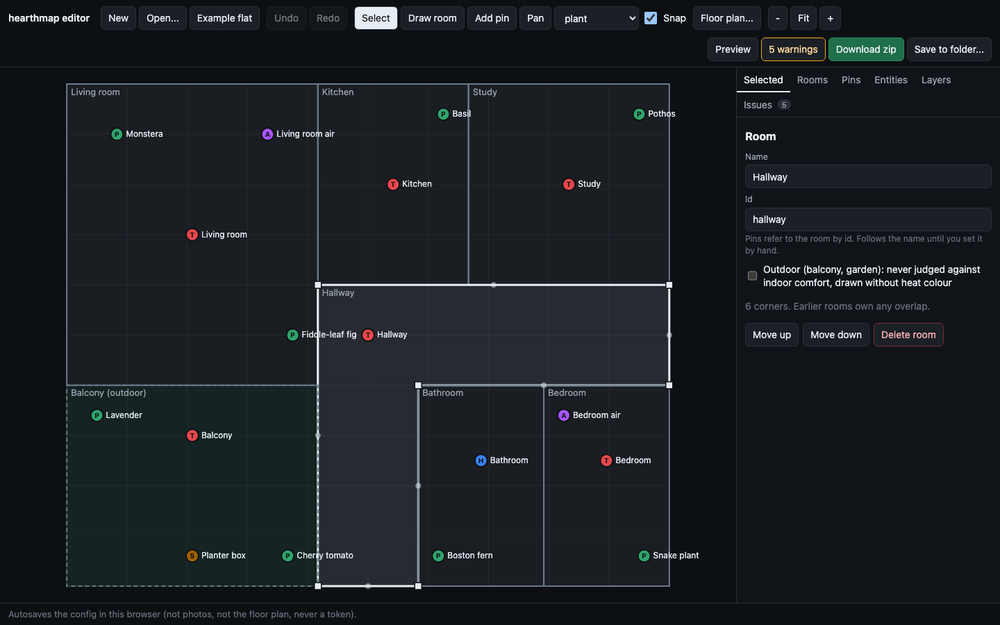

# editor/

A static web app (Vite + TypeScript, no backend) that produces the config the firmware and the
host renderer consume: `config.json`, which must validate against
`schema/hearthmap.schema.json`, plus a `photos/` folder. All data stays in the browser.



```sh
cd editor
npm ci                 # exact versions from package-lock.json; Node 24 (.nvmrc)
npm run dev            # http://127.0.0.1:5174
npm run lint && npm run typecheck && npm test && npm run build
npx playwright install chromium && npm run e2e   # smoke test against the dev server
SCREENSHOTS=1 npm run e2e -- -g screenshots      # regenerate docs/img/editor-*.png
```

## What it does

- **Projects.** Start blank, open a `config.json` (with its photos, or an exported zip), or load
  the fictional example flat. An opened config must be valid against the schema before it
  replaces anything; a rejected file leaves the current project and its autosave untouched.
  Every opened photo is decoded and re-encoded like an attached one (no original bytes or
  metadata survive); files that are not images are reported and dropped. The config autosaves to `localStorage`; photos, the floor plan and
  any token never do. Undo/redo covers every config edit (a drag is one step).
- **Floor plan.** Load an image as a tracing backdrop (opacity slider; never exported). "Match
  plan shape" sizes `canvas.map_area` to the image's proportions within the panel's 960 x 800
  map space, so the plan is not stretched (`schema/README.md`, Coordinates).
- **Rooms.** Draw polygons corner by corner; drag corners; drag the dot on an edge (or
  double-click the edge) to add a corner; select a corner and press Delete to remove it. Snaps to
  existing corners and to horizontal/vertical from neighbouring corners (Alt suspends). Rename,
  mark outdoor, reorder (earlier rooms own overlaps), delete.
- **Pins.** Drop, drag, choose kind, name and room (suggested from the polygon under the pin,
  following the pin when it is dragged into another room). Bind entity ids per role; only roles
  the kind allows are offered (moisture on soil and plant pins only).
- **Entities.** Load or paste a Home Assistant states export (`GET /api/states` output), or fetch
  live with a long-lived token typed into the page. Filter by device class and text; entities
  bound twice are flagged in the list and as warnings.
- **Plant photos.** Names count Unicode code points (at most 48), as the schema and core do.
  Attach an image; the export holds `photos/<photo-id>.png`, a **128 x 128 PNG**
  cut from the centre of the image (128 px is the largest the panel draws a plant photo: the
  detail overlay's disc). The ESPHome component converts it to RGB565 at build time.
- **Calibration.** Set `dry`/`wet`/`happy_min`/`happy_max` per pin, or import the
  `calibration.json` that `tools/calibrate` writes (`schema/calibration.schema.json`). Sensors the
  tool could not calibrate are skipped; confidence, warnings and default happy ranges are shown.
- **Layers.** Bands and thresholds per layer (schema defaults shown as placeholders; "none"
  writes `null`), start-up layer, temperature unit, stale timeout, HUD cap, heat-field tuning.
- **Preview** at 1280 x 800 with sample readings or a readings fixture
  (`schema/readings.schema.json`). It is an approximation for judging placement, drawn after the
  UI spec; the panel's real logic is core's (C++) and its pixels are LVGL's.
- **Export.** Validates with the real schema (Ajv, draft 2020-12, pinned) plus the editor checks
  below; errors block export and are listed next to the offending room, pin or layer. Download a
  zip, or write into a folder through the File System Access API where the browser has it. A
  folder export offers to remove `photos/<photo-id>.png` files an earlier export left there that
  no pin references (a referenced photo whose image is not loaded this session is kept, not
  rewritten); nothing else in the folder is touched.

## Home Assistant token

The token is typed into a password field, read only at the moment of a fetch, sent only to the
address typed next to it, and cleared from the field after a successful fetch. It never enters
application state, `localStorage`, the exported config, a status message or the console
(`src/lib/haClient.ts`; tested in `test/haClient.test.ts` and `e2e/smoke.spec.ts`, risk R-002 in
`docs/repo-map.md`). The browser can reach Home Assistant only if HA lists the page's origin in
`http: cors_allowed_origins`, and a page served over https cannot call an http address.

## Layout

- `src/lib/`: pure TypeScript, unit-tested with Vitest: geometry, ids, edits (`ops.ts`), undo
  history, validation, serialisation, export/import, entities, calibration import, autosave.
- `src/preview/scene.ts`: the preview's view model (pure, tested against the documented outcomes
  of `examples/flat/readings/*`).
- `src/ui/`: thin DOM and canvas code over the above; `src/main.ts` wires it.

Validation in the editor repeats some of core's `validate()` checks (unique ids, room
references, polygon simplicity, calibration width, band order). Core is the enforcement; the
editor's copies only move the message next to the item (`docs/decisions.md` D-040).

## Deploying

`.github/workflows/editor-pages.yml` publishes `dist/` to GitHub Pages. It runs only when
started by hand (`workflow_dispatch`) and needs Pages enabled with GitHub Actions as the source.
